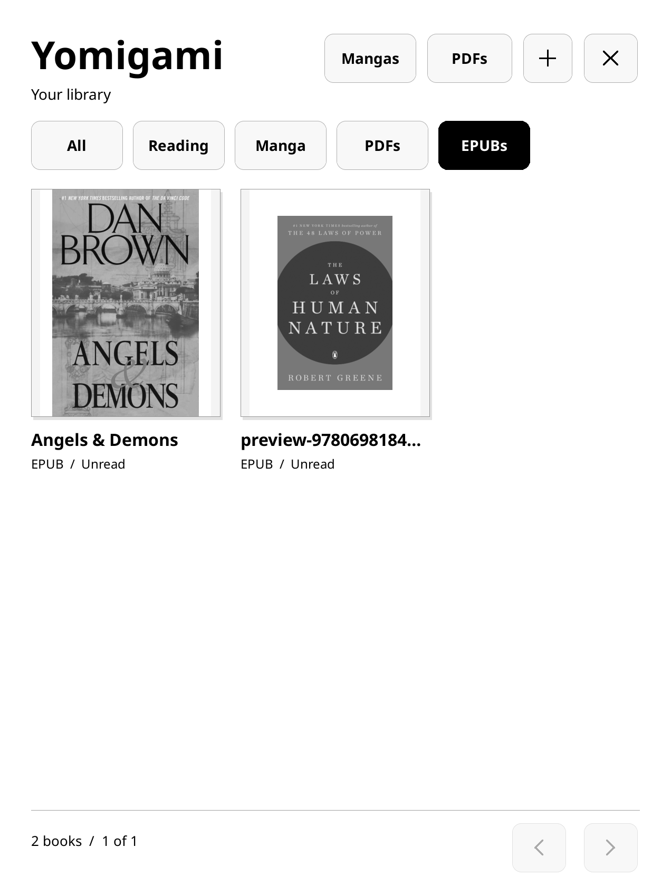

**Yomigami is a manga, PDF and EPUB reader for jailbroken Kindles.** It opens as its own book in your Kindle library. You do not need a separate KOReader installation.

[Download](https://github.com/KapoorCommits/Yomigami/releases/latest) · [Install](docs/INSTALL.md) · [Reader guide](docs/READER_GUIDE.md) · [Report a bug](https://github.com/KapoorCommits/Yomigami/issues)

## What it does

- **Read manga and books.** Browse covers, choose a chapter, and return to your last page.
- **Find manga.** Search 25 bundled source adapters, download individual chapters or a whole series, and manage the queue.
- **Keep up with a series.** Check for new chapters and download them automatically. Checks run while Yomigami is open; missed checks catch up when you reopen it.
- **Make pages fit.** Adjust crop, contrast, zoom, reading direction and EPUB font size. Each book keeps its own settings.
- **Highlight and take notes.** Highlight selectable text in PDFs and EPUBs, then export your notes as Markdown. Image-only scans do not support text selection.
- **Send books over Wi-Fi.** Scan a QR code with your phone or open the local address on a computer. Upload PDF, EPUB or CBZ files without USB.
- **Manage storage.** See how much space each book uses, remove downloads, and restore books from Recently deleted.
- **Read comfortably.** Use brightness and warmth controls, light or dark mode, configurable screen refresh, and an optional numeric app passcode.

Yomigami includes its own pinned KOReader runtime and Rakuyomi manga engine. Updating a separate KOReader installation does not update Yomigami's reader.

## Screenshots

Captured directly from a Kindle Paperwhite 12 at 1272 × 1696. The manga reader has its toolbar hidden. These are device screenshots, not mockups. Books shown are not included in the download.

| Books library | Manga reader |
| --- | --- |
|  |  |

## Install

**Tested target: jailbroken Kindle Paperwhite 12th generation, firmware 5.18.5.0.1, with a working scriptlet book launcher.** Other Kindle models and firmware versions are unverified. The ZIP does not jailbreak your device.

1. Open the [latest release](https://github.com/KapoorCommits/Yomigami/releases/latest).
2. Download **Yomigami-0.5.0-Paperwhite12-Install.zip** for a first installation, or **Yomigami-0.5.0-Paperwhite12-Update.zip** if you already use Yomigami.
3. Extract the ZIP on your computer and follow `START_HERE.txt`.

Use the named installer ZIP, not GitHub's automatic **Source code (zip)** download. The [installation guide](docs/INSTALL.md) explains which files to copy and how to back up your books.

## A few things to know

This is a young project, tested on one Kindle model. Keep a backup of your library and reading data.

Manga sites can change, go offline or block requests. A bundled adapter does not guarantee that a site works today. See the [source list](docs/SOURCES.md). Online searches and downloads need Wi-Fi; downloaded books can be read offline. Downloads stop when the app closes. Scheduled checks do not wake a sleeping Kindle.

The passcode locks the app interface; it does not encrypt files. DRM-protected books and OCR are not supported. Yomigami does not change the stock Kindle Home screen.

## Build and contribute

See [BUILDING.md](docs/BUILDING.md) for setup, packaging and tests, and [CHANGELOG.md](CHANGELOG.md) for changes. Bug reports are most useful with your Kindle model, firmware, Yomigami version and steps to reproduce the problem. Remove account details from logs before sharing them.

Pull requests are welcome. [@KapoorCommits](https://github.com/KapoorCommits) reviews changes before they merge. See [CONTRIBUTING.md](CONTRIBUTING.md) and [GOVERNANCE.md](GOVERNANCE.md).

## Credits and license

Built on [KOReader](https://github.com/koreader/koreader) for device support and rendering, and [Rakuyomi](https://github.com/tachibana-shin/rakuyomi) for the manga engine. Thanks also to Aidoku's source maintainers and the upstream libraries these projects depend on.

Yomigami is licensed under [AGPL-3.0-or-later](LICENSE). Bundled components keep their own licenses. See [THIRD_PARTY_NOTICES.md](THIRD_PARTY_NOTICES.md) and the [release source notes](docs/RELEASE-SOURCES.md).
